# Roadmap: what we build next, and why

Draft, 2026-10-19. For the team. Written in plain language on purpose; the detailed research behind every claim
is listed at the end.

## 1. The idea in one picture

```mermaid
flowchart LR
    A[You give a task] --> B[Agent reads the real build files<br/>and runs the fact scripts]
    B --> C{Anything the repo<br/>cannot answer?}
    C -- yes --> D[Multiple-choice questions to you]
    C -- no --> E
    D --> E[Snapshot: tests, coverage,<br/>security findings, app startup]
    E --> F[Plan with numbered steps,<br/>you say go]
    F --> G[Recipe makes the<br/>mechanical change]
    G --> H[Agent fixes what the<br/>recipe left behind]
    H --> I{Scripts compare<br/>against the snapshot}
    I -- worse on any axis --> H
    I -- not worse --> J[Commit point: you commit]
    J --> K[Report assembled from<br/>the work files]
    K --> L[Numbers go to a dashboard:<br/>cost, merged untouched, reverted]
```

Everything new in this roadmap strengthens one box in that picture. Nothing in it is a smarter prompt.

## 2. What we learned from the research

We looked at three things: the tools that exist for Java, what Copilot itself can do beyond chat, and how the big
players do this (Google, Moderne, AWS, Spotify, Netflix, Adyen, and a dozen smaller tools).

**Finding 1: agents cheat when they get stuck.** Not on purpose. They delete a failing test so the build goes green.
They say "done" at 95 percent. They copy a fix from the internet instead of understanding the code. AWS said this
publicly about their own tool. A Cursor audit found most "successful" benchmark fixes were copied, not derived.
Google reverted unwanted edits in most of their AI-generated changes.

**Finding 2: the only fix that works is checking with a tool, never with the agent's own word.** Every company that
does this at scale uses the same shape: find the places to change with a tool, make the change with a recipe or the
model, then run a ladder of checks from cheap to expensive, then let a human review a small change. That is what the
picture above shows.

**Finding 3: vendors still rely on prompts for the dangerous parts.** Their instructions say "never delete tests".
Ours do too. A prompt is a request; a script is a rule. We can be the ones with the rule.

**Finding 4: Java is the hard case.** AI agents score about half as well on Java as on Python in public benchmarks,
mainly because they cannot find the right place to change in a large codebase. Tools that understand types, like
OpenRewrite's search recipes, fix exactly that.

**Finding 5: nobody publishes honest numbers.** Google and Adyen do internally: roughly 70 to 87 percent of AI changes
merged untouched. No vendor does. An independent study put Copilot's own coding agent at 43 percent. If we measure,
we will know, and we can prove the value.

## 3. What makes ours different

| | What it means | Who else does it |
|---|---|---|
| **Cheating is impossible, not forbidden** | Before a task we snapshot the tests, coverage, security findings and how the app starts. The agent cannot finish if any of those got worse. A script decides, not the agent. | Nobody in the Copilot world. Claude Code has the hooks but no Java checks. |
| **Facts come from tools** | The plan quotes lists produced by scripts: which classes use a removed API, which dependency has a fix and in what version, which code is risky and untested. Across all repositories, in one table. | Only Moderne, at $250,000 and up. |
| **The app is started, not just compiled** | For Spring upgrades we start the application and compare its beans and settings before and after. Unit tests miss these failures; this catches them. | Nobody. |
| **Reviewers get small, honest pull requests** | Changes made by a recipe can merge on green automatically. Changes the model wrote stay under five files and get a human. The description says which is which. | Google and Adyen internally. |
| **We publish our numbers** | Cost per merged change, merged untouched, reverted within a month, how much was recipe versus model. | Nobody sells this. |
| **Repeated fixes become recipes** | When the model fixes the same thing by hand in several repositories, we turn it into a tested OpenRewrite recipe, so the next repository needs no AI. Our own recipe catalogue, free licence. | Moderne has the pieces but does not connect them. |
| **No lock-in** | Works on Kotlin and Groovy build files, behind a corporate mirror, on the Copilot seats you already pay for. | Copilot's own tool: no Kotlin DSL, one repo at a time. AWS: Maven only. Moderne: six-figure contracts. |

## 4. Is this better than just using OpenRewrite?

OpenRewrite is one tool inside the pack, not an alternative to it. It applies a known rule to code, renaming a
package, replacing an API, bumping a version, and it does that perfectly, everywhere, every time. That is why we use
it for every change that can be written as a rule. What it does not do is where the rest of the pack earns its place.

| OpenRewrite alone | The pack |
|---|---|
| Does not decide what to run. Someone must know which recipes, in which order, with which local exceptions. | The planner and agent tables hold that knowledge; the team rules file adds the local exceptions. |
| Does not handle what the rule missed. Its own documentation says recipes favour correctness over completeness, so migrations stay partial. | The agent fixes the residue one cause at a time, with a compile check after each. |
| Does not verify. It reports "changed 14 files" but runs no tests, starts no app, rescans no CVE. If a dependency fails to resolve it silently skips files and still reports success, the top failure mode in the field. | Baseline snapshot, missing-type gate, cannot-finish check, app startup comparison. |
| Does not write tests or documentation, and does not triage a scanner report. | Three of the six agents do work OpenRewrite cannot. |
| Does not run itself: coordinates, directory, memory, reading the patch, applying, committing. | The script runs it from the root with pinned versions; the setup check proves the environment first. |
| Does not learn. The same hand-fix in five repositories goes unnoticed. | Phase 4 turns repeated fixes into new recipes so the sixth repository needs no AI. |

A fair summary: OpenRewrite answers "how do I apply this known change everywhere". The pack answers "what change does
this repository need, what did the recipe leave behind, is the result actually correct, and what did it cost".

Moderne, the company behind OpenRewrite, sells exactly this layer on top of it: planning, multi-repository runs, fact
tables, verification. Their price starts in the six figures and their recipes are moving to a licensed distribution.
The pack reproduces most of that layer on Copilot seats we already have, plus the parts they do not do: test writing,
documentation, runtime checks, and the guards against an agent cheating.

## 5. The plan, in four phases

### Phase 1: make cheating impossible (4 to 6 weeks)

The most valuable phase. Everything else builds on it.

| What | In plain words |
|---|---|
| Baseline snapshot | Before the agent touches anything: list of tests and how many assertions each has, which tests are flaky, coverage numbers, security findings, the REST contract, and how the Spring app looks when it starts. Saved next to the task. |
| Test guard | If a test file outside the task's scope changes, a test disappears, assertions drop, or a test gets disabled, the hook blocks it. |
| Cannot-finish gate | When the agent says it is done, a hook runs the comparison. Red means the agent keeps working or stops and reports; it cannot declare victory. |
| App startup check | Start the Spring app before and after, compare beans and settings, read the property-migration warnings as a list. |
| Architecture and contract checks | Existing ArchUnit rules must still pass; the REST contract must have no breaking change. Both are one command each. |
| Recipe versus model | Every step records which files the recipe changed and which the model changed. The pull request shows both lists. |
| Better security facts | Use a scanner that returns the fixed version in JSON, instead of reading a CSV from the ticket. |
| Hooks that help, not only block | Inject the repository facts at the start of every session; write every tool call to an audit file. |
| Per-task record | What it cost, what changed, what was verified, what the reviewer did. One file per task. |

### Phase 2: give the agent facts (4 weeks)

| What | In plain words |
|---|---|
| Type-aware search | Use OpenRewrite search recipes instead of grep to find what must change. If the parser could not resolve a type, the plan fails loudly instead of silently missing files. |
| Inventory across repositories | One table of Java level, framework versions, dependencies, deprecated API use, endpoints, per repository. Refreshed weekly. |
| Where to spend effort | Rank classes by how often they change times how much untested logic they have. The test agent starts at the top. |
| Coverage and mutation ratchet | Coverage of touched classes may not drop. Mutation testing on touched classes may not drop. |
| Analyser ratchet | SpotBugs, Checkstyle, PMD or Sonar, whichever the repository already runs: no new findings. |
| Faster inner loop | Compile only changed modules, run only the tests that cover changed classes, full suite once at the end. |
| Dependency bump gate | A version bump is accepted only after affected tests, an API-compatibility check and a security re-scan. Never a downgrade. |
| Cheaper models for mechanical steps | The planner's triage and the fix loops on a cheap model, the hard reasoning on a strong one. Set per agent. |
| JetBrains gaps | Run the pack through Copilot's CLI provider inside IntelliJ, which has the full hook and skill support. |

### Phase 3: run without a person at the keyboard (4 to 6 weeks)

| What | In plain words |
|---|---|
| Scheduled runs | Copilot CLI inside GitHub Actions, billed to the company pool, with a spending cap per run. Nightly cleanup, weekly inventory. |
| Code review enforcement | Copilot code review reads our rules and reviews every pull request an agent opens. |
| Allowed tools only | A short list of approved integrations (GitHub, SonarQube read-only), nothing else attachable. |
| Dashboard | Weekly job that publishes cost per merged change, merged untouched, reverted within 30 days, per agent and model. |
| Regression tests for the pack itself | A few fixture projects (Gradle Kotlin, Gradle Groovy, Maven, legacy JUnit 4). Every change to an agent file is run against them in CI. |
| Database and build checks | Migrations validated and applied on a throwaway database; a repeatable-build check that proves a refactor changed no bytecode. |

### Phase 4: many repositories, and learning (6 to 10 weeks)

| What | In plain words |
|---|---|
| Campaigns | One file listing target repositories, steps, and the order: three canary repositories first, then ten, then all. |
| Rollout controls | Limit how many pull requests per hour, work in the owners' office hours, close stale ones, a stop button. |
| Two kinds of pull request | Recipe-only: auto-merge on green. Model-touched: human review, small, with a sampled second reviewer. |
| Watch after merge | Track reverts and CI failures for 30 days after each campaign change. |
| Memory of solved problems | Store each error-plus-fix pair with its success rate. Reuse the good ones as examples, retire the bad ones. |
| Promote fixes to recipes | When the same fix succeeded in several repositories, author a recipe with tests and drop the AI step for that pattern. |
| Cloud runs for bulk work | Copilot's cloud agent with a pre-installed JDK and access to the corporate mirror, for large batches. |

## 6. What we measure from day one

- **Merged untouched, merged with edits, rejected.** The honest acceptance rate.
- **Reverted within 30 days, and CI failures after merge.** Green on the day is not enough; Spotify learned that the hard way.
- **Recipe files versus model files per pull request.** Shows where a recipe is still missing.
- **Cost per merged change**, per agent, per model.
- **Which check caught the failure.** Tells us which cheap check to add next.

## 7. Risks, and what we do about them

- **The IntelliJ plugin does not support every hook yet.** We run the pack through Copilot's CLI provider inside IntelliJ, and every gate also runs in CI, so the IDE is never the only line of defence.
- **OpenRewrite licensing is shifting.** Some recipes moved to a source-available licence and off Maven Central. We pin versions, mirror them, and build our own catalogue of free-licence recipes over time.
- **Tools can lie to the agent.** One testing library now prints text aimed at AI agents in its output. Agents only read script summaries, never raw logs, and a hook strips known markers.
- **Reviewers get tired.** Small pull requests, auto-merge for recipe-only changes, a second reviewer on a sample.
- **Building too much.** Each feature ships only after the number it is supposed to improve is being measured. Phase 1 before anything else.

## 8. Decisions we need

1. Approve Phase 1 and name an owner.
2. Which code analysers the repositories already run, so we wrap those and not new ones.
3. Whether company policy allows Copilot CLI to run in GitHub Actions on the company bill.
4. A bot account for unattended runs, so cost can be attributed.
5. The legal view on the source-available OpenRewrite recipes, and whether a Moderne subscription is on the table.
6. Three canary repositories for Phase 4, and who holds the stop button.

## 9. Where the detail is

The research behind this document, with sources: a tooling survey of about 40 Java tools with their output formats and
commands; a survey of Copilot platform features (hooks, skills, CLI, cloud agent, code review, metrics, governance); and
a landscape of 20 commercial and open-source systems with a capability matrix. They are long and technical; they are for
whoever implements a feature, not for reading end to end. Ask for the one you need and it goes into `docs/research/`.
